# Pillar

**A portrait-first, visuals-first ROM manager and emulation frontend for Android phones.**

Pillar organizes your game collection for holding your phone upright. It launches the emulators
you already have, downloads games from your own [RomM](https://romm.app) server, keeps your
RetroArch saves in sync, and shows your [RetroAchievements](https://retroachievements.org)
progress. Almost everything about how it looks can be changed.

> Pillar is a frontend. It does not include games or emulators.

<p align="center">
  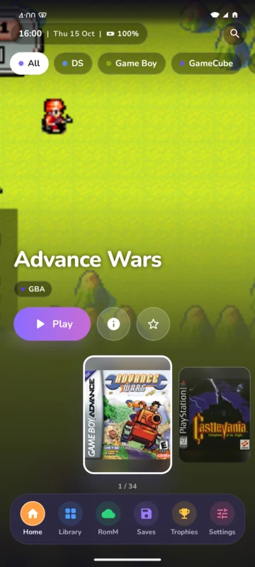
  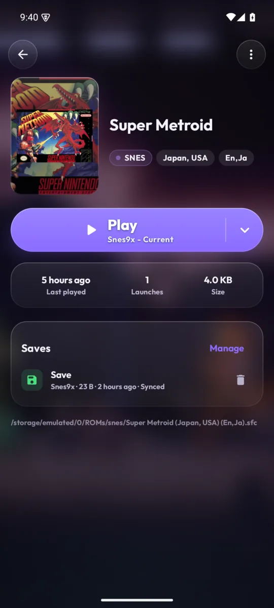
  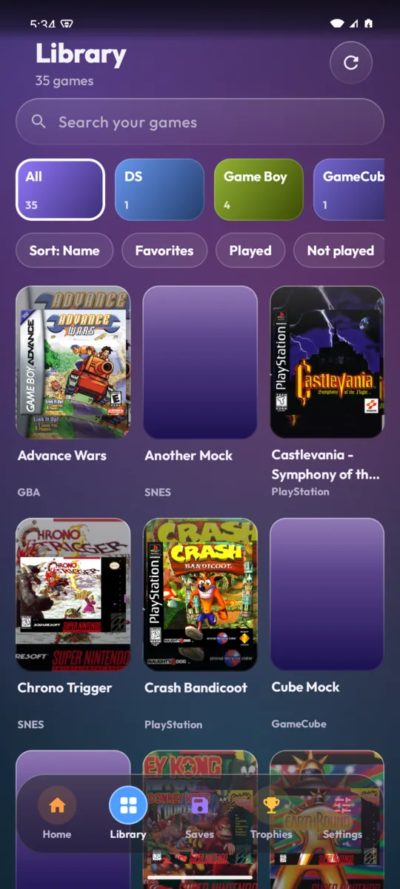
  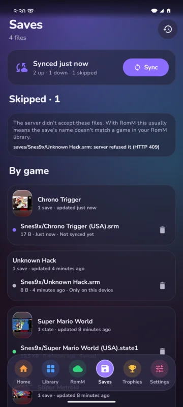
</p>
<p align="center">
  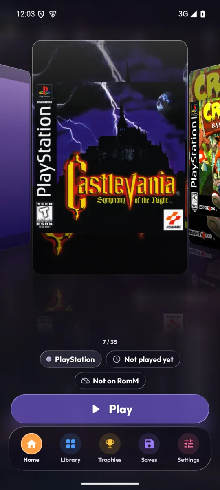
  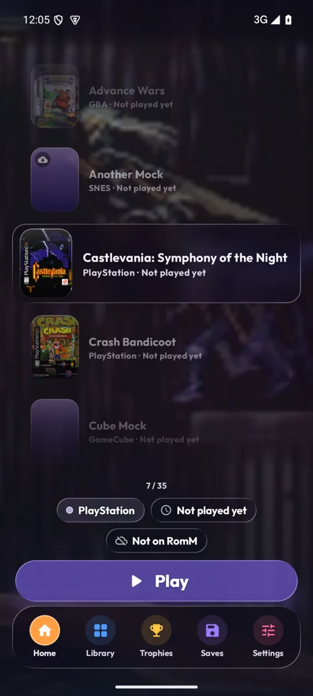
  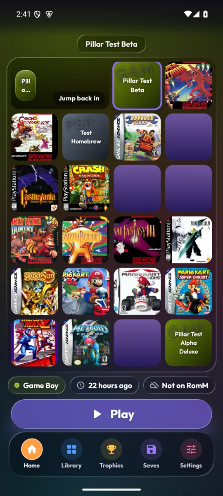
  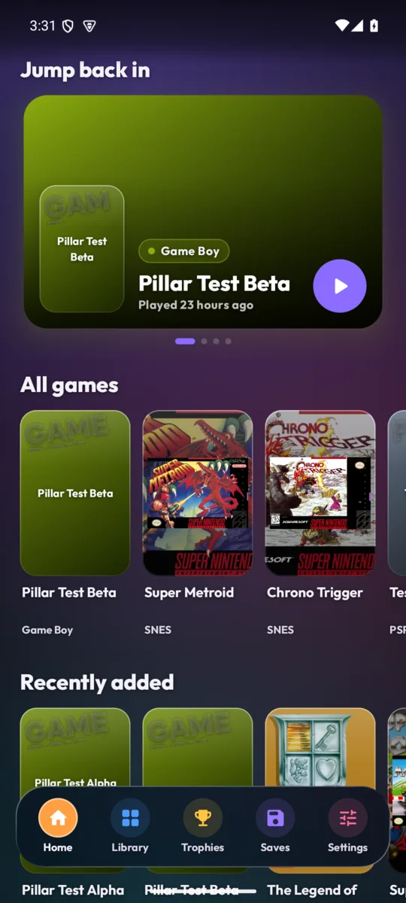
</p>
<p align="center">
  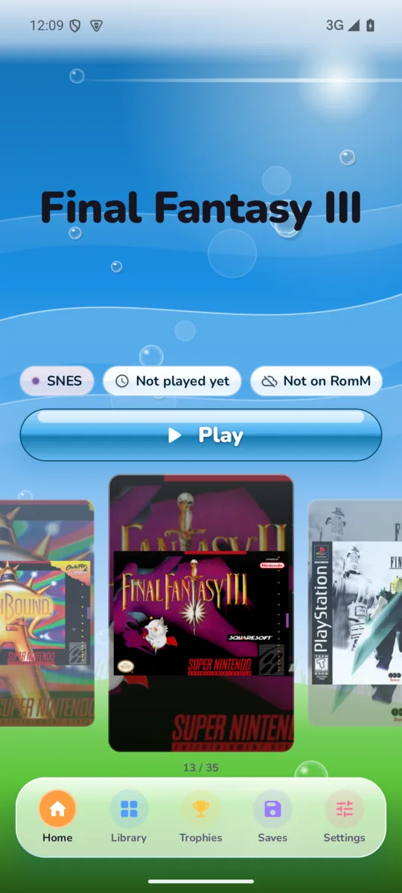
  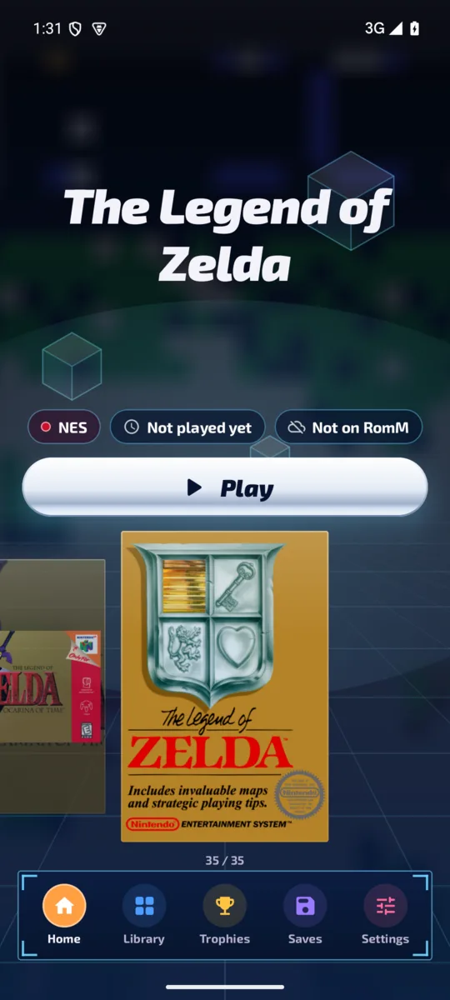
  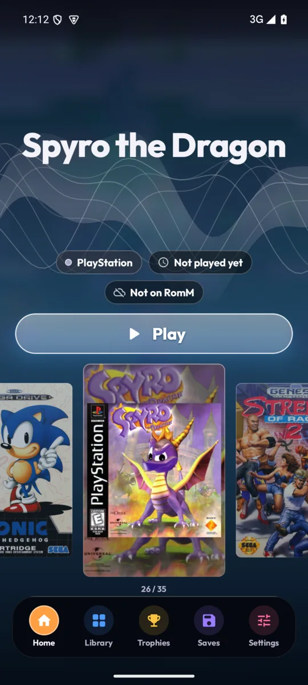
  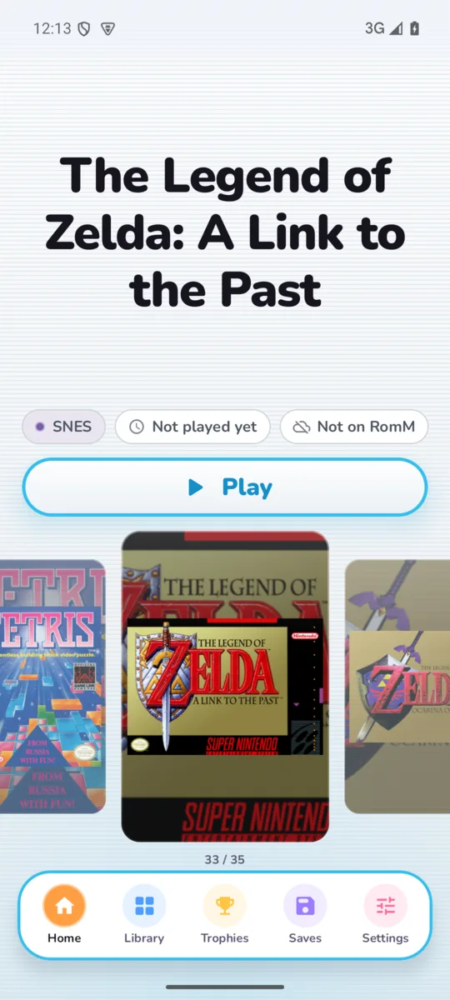
  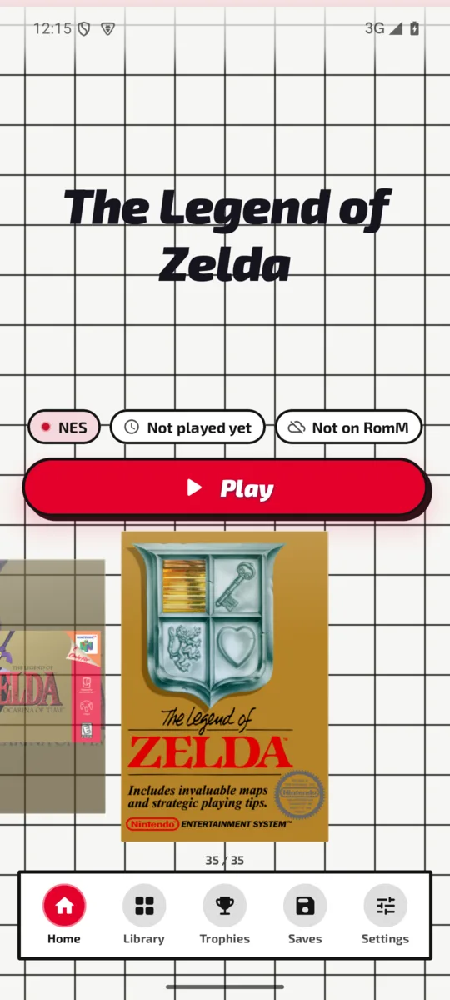
</p>
<p align="center"><sub>Liquid Glass (top); Cover flow, List, Grid and the widget feed; Frutiger Aero, Y2K, XMB, Wii and Grid</sub></p>

## Install

Grab the APK from [Releases](../../releases/latest), or track it with
[Obtainium](https://github.com/ImranR98/Obtainium) so you get updates automatically:

1. In Obtainium, tap **Add App**.
2. Paste `https://github.com/Audxius/Pillar` and tap **Add**.

Android 8.0 or newer.

## Features

- **Built for portrait.** Home is every game, most recently played first, as a snapping cover
  carousel (or a vertical list, if you prefer) under the focused game's big logo, with its system, when you last played it and
  whether it has achievements. Tap a cover to open its page; Play is right there, and search is
  one tap away. Cover tiles
  stay uniform: art that doesn't match the tile is shown whole in a frame instead of cropped.
- **Game pages.** Cover, logo, the emulator it will use right above Play, save files, RomM info
  and every achievement (still to unlock first). Favorite, cover, rename and hide live in the ⋮ menu.
- **Library.** Your consoles as cards (controller icon over a tinted collage of their games);
  pick one to browse its games with search, sort, filters and its default emulator.
- **Knows your games.** Cartridge-era ROMs are identified by checksum against the No-Intro
  databases, so a file called `sonic3k.md` still gets its real name, box art and logo.
- **Six looks, each with its own color schemes.** Liquid Glass (default: Apple-style glass that
  refracts your game's art); Frutiger Aero (Windows 7 glass over a bright sky, glossy grass, water
  drops and bubbles); Y2K (PS2 and Dreamcast menus: a grid floor fading into fog, see-through
  cubes, HUD panels, chrome buttons); XMB (the PSP/PS3 wave, in its monthly colors); Wii (white
  pinstripes and Wii-blue rims); and Grid (8-bit era box art: a black grid on white, one bold
  color). Menu sounds to match each one.
- **Four ways to browse.** Covers; a big 3D cover flow where the game in the middle can slide
  its real disc or cartridge out of the case; an iiSU-style **Grid** of icons (2 to 5 columns);
  or a **List**. Disc and cartridge art comes from ES-DE's media folder, RomM's ScreenScraper
  media, or LaunchBox's Games Database (a one-time download).
- **One library.** Games on your phone and on your RomM server show up together; RomM-only games
  have a cloud badge, and Play downloads them, then starts them.
- **Your library.** Point it at your ROMs folder (one sub-folder per system, the same layout as
  ES-DE). Multi-disc games and `.cue`/`.bin` sets show up once.
- **200+ systems and hundreds of emulators.** Uses ES-DE's open Android system and emulator
  definitions: RetroArch cores, Dolphin, AetherSX2/NetherSX2, DuckStation, PPSSPP, melonDS,
  Azahar, Eden, Flycast, MAME4droid and many more. Choose a default per system or per game (from
  the arrow on the Play button), or write your own launch command. Pillar never launches a
  RetroArch core it doesn't know you have, since a missing core leaves RetroArch on a black screen.
- **Artwork.** Box art from the libretro thumbnail server with fuzzy name matching (so
  "Final Fantasy 3.sfc" still finds its cover), your RomM covers, ES-DE's `downloaded_media`
  folder, or [SteamGridDB](https://www.steamgriddb.com) with a free API key (covers, square icons,
  wide backgrounds, logos). Cover tiles are 2:3, close to most game boxes, and covers are never
  cropped by more than a sliver unless you want them to be.
- **Saves & sync.** Lists every save file and save state by game. Syncs with the same WebDAV
  server RetroArch's Cloud Sync uses (including RomM's `/api/sync/retroarch`), with RetroArch's
  own manifest format and rules, every time you open Pillar. Sync is non-destructive: it never
  deletes anything on the server and backs up any save before replacing it. When a save changed
  on both sides, you see how old each copy is and pick which to keep. Shared memory cards (PS2,
  Dreamcast, GameCube, Wii, PSP) are shown with every game of that console, read straight from the
  server's system folder (no local folder needed): save a copy, or replace one on the server (its
  old copy is backed up first). Pick RetroArch's system folder too to keep a copy on the device in
  sync (only save data, never BIOS). Saves can be deleted right from a game's page. Your RomM save slots show on
  each game's page: play from any of them, or make one your main save. A small indicator shows while
  saves sync, optionally even over a game you've gone back into.
- **RomM downloads.** Games land in the right system folder; multi-file games are extracted for
  you, and downloads keep going in the background. Games that aren't on RomM yet are marked and
  can be uploaded from their page, and duplicates can be deleted from the device, RomM or both.
- **RetroAchievements.** Profile and your games as expandable cards with the achievements you
  still need listed first; games without a set are marked "No achievements", and games you've
  given up on can be reset on retroachievements.org from the ⋮ menu. Local games are matched in the background by ROM hash, like
  RetroArch, falling back to the title; RomM games use RomM's match. You can also set a game ID
  by hand.
- **Customize everything.**
  - Theme: color schemes made for each style, any accent color, Material You, dark / AMOLED black / light.
  - Fonts: Nunito, Outfit, Space Grotesk, Exo 2, a pixel font, or the system font, plus text size.
  - Background: the focused game's art, animated aurora, gradient, solid or your own image (with
    blur and dim), tinted by the platform or game on screen.
  - Corner roundness, frosted or solid cards, cover shape, grid columns, titles on/off.
  - Widget home layout: continue playing, recent (your whole library by recently played),
    favorites, recently added, random pick and stats, which you can toggle and reorder.
  - Platforms: show, hide, rename, recolor and reorder.
  - Haptics, click sounds, animations, orientation.
  - Export and import all of it as a backup file.
- **Controller friendly.** D-pad focus highlights; A selects and B goes back.

## Setting up

1. **ROMs:** Settings → Library → Add folder. Pick the folder that contains `snes`, `gba`,
   `psx` and so on.
2. **RomM (optional):** Settings → RomM. Enter your server address and username/password, or a
   client API token.
3. **RetroAchievements (optional):** Settings → RetroAchievements. Enter your username and your
   web API key from retroachievements.org → Settings.

RetroArch and a few other emulators need ROMs on real device storage (internal storage or SD card)
because they open files by path.

## Building

```sh
./gradlew assembleDebug        # debug APK
./gradlew testDebugUnitTest    # unit tests
```

Releases are built by GitHub Actions when a `v*` tag is pushed. Signing uses four repository
secrets: `PILLAR_KEYSTORE_BASE64`, `PILLAR_KEYSTORE_PASSWORD`, `PILLAR_KEY_ALIAS` and
`PILLAR_KEY_PASSWORD`.

## Credits

- [ES-DE](https://es-de.org) for the system and emulator definitions (MIT).
- [RomM](https://romm.app), [RetroAchievements](https://retroachievements.org) and the
  [libretro thumbnails](https://thumbnails.libretro.com) project.
- [LaunchBox Games Database](https://gamesdb.launchbox-app.com) for disc and cartridge art
  (downloaded on request).
- [libretro-database](https://github.com/libretro/libretro-database) for the No-Intro checksum
  databases used to identify games (downloaded on demand).
- [Backdrop](https://github.com/Kyant0/AndroidLiquidGlass) by Kyant (Apache 2.0) for the Liquid
  Glass effect.
- Console icons from libretro's [retroarch-assets](https://github.com/libretro/retroarch-assets)
  (monochrome XMB theme, CC BY 4.0), loaded on demand.
- Inspired by the look of [iiSU](https://github.com/iisu-network/iiSU). Pillar is an independent
  project and shares no code or assets with it.

## License

MIT. See [LICENSE](LICENSE) for bundled third-party licenses.
