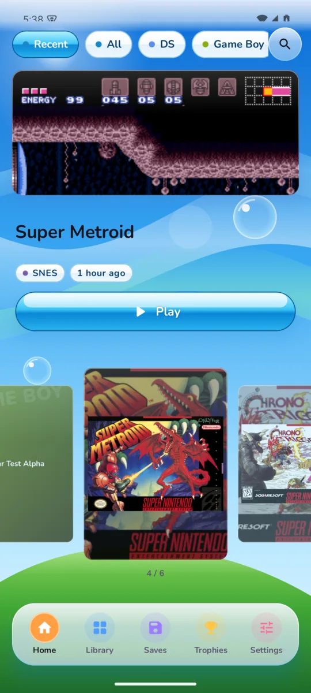
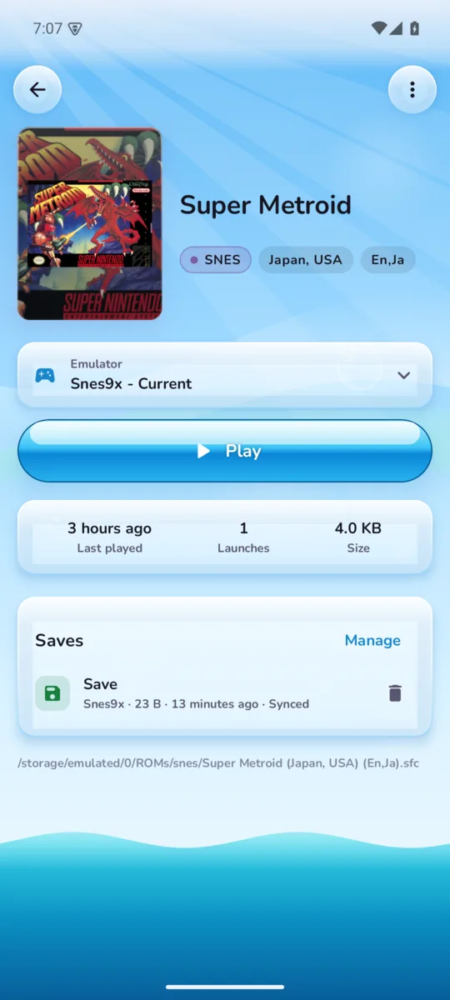
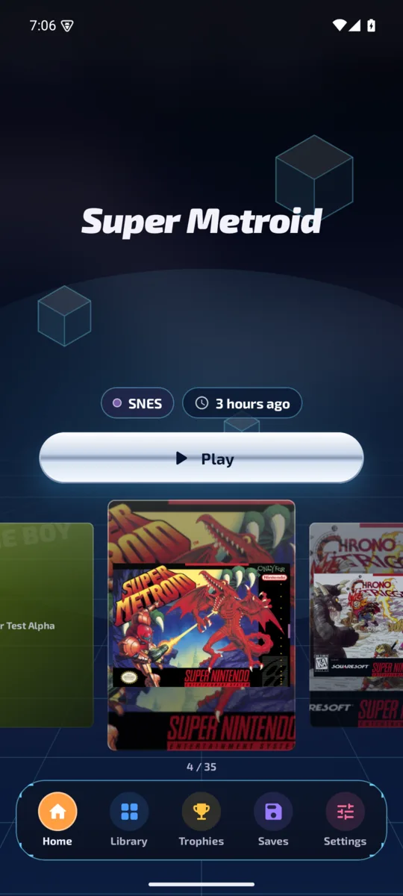
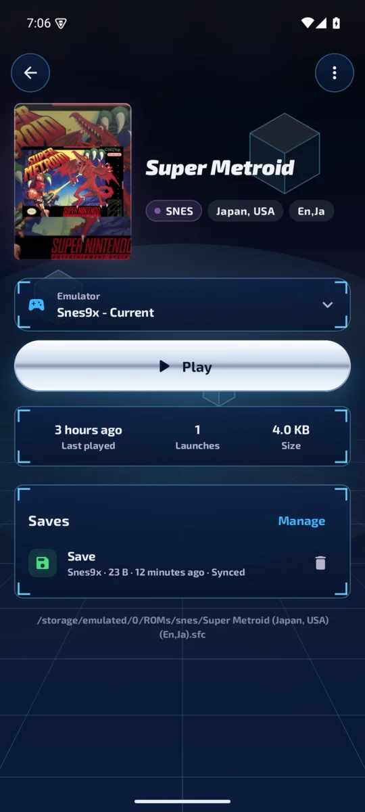

# Pillar

**A portrait-first, visuals-first ROM manager and emulation frontend for Android phones.**

Pillar organizes your game collection for holding your phone upright. It launches the emulators
you already have, downloads games from your own [RomM](https://romm.app) server, keeps your
RetroArch saves in sync, and shows your [RetroAchievements](https://retroachievements.org)
progress. Almost everything about how it looks can be changed.

> Pillar is a frontend. It does not include games or emulators.

<p align="center">
  
  
  
  
</p>
<p align="center">
  
  
  
  
</p>
<p align="center"><sub>Glassmorphism (top), Frutiger Aero and Y2K (bottom)</sub></p>

## Install

Grab the APK from [Releases](../../releases/latest), or track it with
[Obtainium](https://github.com/ImranR98/Obtainium) so you get updates automatically:

1. In Obtainium, tap **Add App**.
2. Paste `https://github.com/Audxius/Pillar` and tap **Add**.

Android 8.0 or newer.

## Features

- **Built for portrait.** Home is every game, most recently played first, as a snapping cover
  carousel under the focused game's big logo, with its system, when you last played it and
  whether it has achievements. Tap a cover to open its page; Play is right there. Cover tiles
  stay uniform: art that doesn't match the tile is shown whole in a frame instead of cropped.
- **Game pages.** Cover, logo, the emulator it will use right above Play, save files, RomM info
  and every achievement (still to unlock first). Favorite, cover, rename and hide live in the ⋮ menu.
- **Library.** Your consoles as cards; pick one to browse its games with search, sort, filters
  and its default emulator, in an evenly aligned cover grid.
- **Three looks.** Glassmorphism (default: your game's art behind frosted panels); Frutiger Aero
  (Vista sky, light rays, bubbles, glossy glass and aqua buttons); and Y2K (PS2 and Dreamcast
  menus: a grid floor fading into fog, see-through cubes, HUD panels, chrome buttons, Exo 2
  type). Each has its own backdrop, panels, buttons and dock.
- **One library.** Games on your phone and on your RomM server show up together; RomM-only games
  have a cloud badge, and Play downloads them, then starts them.
- **Your library.** Point it at your ROMs folder (one sub-folder per system, the same layout as
  ES-DE). Multi-disc games and `.cue`/`.bin` sets show up once.
- **200+ systems and hundreds of emulators.** Uses ES-DE's open Android system and emulator
  definitions: RetroArch cores, Dolphin, AetherSX2/NetherSX2, DuckStation, PPSSPP, melonDS,
  Azahar, Eden, Flycast, MAME4droid and many more. Choose a default per system or per game, or
  write your own launch command.
- **Artwork.** Box art from the libretro thumbnail server with fuzzy name matching (so
  "Final Fantasy 3.sfc" still finds its cover), your RomM covers, ES-DE's `downloaded_media`
  folder, or [SteamGridDB](https://www.steamgriddb.com) with a free API key (covers, square icons,
  wide backgrounds, logos). Covers are never cropped unless you want them to be.
- **Saves & sync.** Lists every save file and save state by game. Syncs with the same WebDAV
  server RetroArch's Cloud Sync uses (including RomM's `/api/sync/retroarch`), with RetroArch's
  own manifest format and rules, every time you open Pillar. Sync is non-destructive: it never
  deletes anything on the server and backs up any save before replacing it. When a save changed
  on both sides, you see how old each copy is and pick which to keep.
- **RomM downloads.** Games land in the right system folder; multi-file games are extracted for
  you, and downloads keep going in the background.
- **RetroAchievements.** Profile and your games as expandable cards with the achievements you
  still need listed first. Local games are matched in the background by ROM hash, like
  RetroArch, falling back to the title; RomM games use RomM's match. You can also set a game ID
  by hand.
- **Customize everything.**
  - Theme: 10 palettes, any accent color, Material You, dark / AMOLED black / light.
  - Fonts: Nunito, Outfit, Space Grotesk, Exo 2, a pixel font, or the system font, plus text size.
  - Background: the focused game's art, animated aurora, gradient, solid or your own image (with
    blur and dim), tinted by the platform or game on screen.
  - Corner roundness, frosted or solid cards, cover shape, grid columns, titles on/off.
  - Feed home layout: 10 widgets (clock, continue playing, platforms, favorites,
    RetroAchievements, RomM, random pick, stats…) that you can toggle and reorder.
  - Platforms: show, hide, rename, recolor and reorder.
  - Haptics, click sounds, animations, orientation.
  - Export and import all of it as a backup file.
- **Controller friendly.** D-pad focus highlights; A selects and B goes back.

## Setting up

1. **ROMs:** Settings → Library → Add folder. Pick the folder that contains `snes`, `gba`,
   `psx` and so on.
2. **RomM (optional):** Settings → RomM. Enter your server address and username/password, or a
   client API token.
3. **RetroAchievements (optional):** Settings → RetroAchievements. Enter your username and your
   web API key from retroachievements.org → Settings.

RetroArch and a few other emulators need ROMs on real device storage (internal storage or SD card)
because they open files by path.

## Building

```sh
./gradlew assembleDebug        # debug APK
./gradlew testDebugUnitTest    # unit tests
```

Releases are built by GitHub Actions when a `v*` tag is pushed. Signing uses four repository
secrets: `PILLAR_KEYSTORE_BASE64`, `PILLAR_KEYSTORE_PASSWORD`, `PILLAR_KEY_ALIAS` and
`PILLAR_KEY_PASSWORD`.

## Credits

- [ES-DE](https://es-de.org) for the system and emulator definitions (MIT).
- [RomM](https://romm.app), [RetroAchievements](https://retroachievements.org) and the
  [libretro thumbnails](https://thumbnails.libretro.com) project.
- Inspired by the look of [iiSU](https://github.com/iisu-network/iiSU). Pillar is an independent
  project and shares no code or assets with it.

## License

MIT. See [LICENSE](LICENSE) for bundled third-party licenses.
